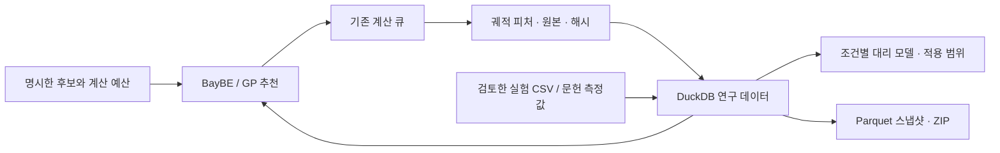

# Polymer Lab · 개인 고분자 연구 워크벤치

고분자 구조 생성·MD·궤적 분석과 단백질 구조 가져오기/예측 작업을 한 로컬 화면에서 관리합니다. 계산은 별도 프로세스에서 실행하고, 설정·로그·원본 파일·라이브러리 버전·해시를 작업별로 보존합니다. 한국어 화면과 로컬 3Dmol.js 뷰어를 포함합니다.

## 데스크톱 프로그램 실행

**Polymer Lab 0.3**는 독립된 창·한국어 메뉴·파일 가져오기·저장 창을 갖춘 Linux 데스크톱 프로그램입니다. 계산 서버를 자동으로 시작하고, 프로그램을 닫으면 진행 중인 계산을 중단한 뒤 기록을 보존합니다.

이 컴퓨터에서는 앱 메뉴 또는 바탕화면의 **Polymer Lab 고분자 연구실**을 실행합니다. 배포본은 Python을 별도로 설치할 필요가 없습니다.

```sh
~/.local/bin/polymer-lab
```

배포 파일은 `releases/`의 Linux x86_64 압축 파일과 `.deb`입니다. 현재 Kali Linux의 glibc 2.43 환경에서 빌드했으므로 다른 운영체제·이전 Linux 배포판에서의 실행을 보장하지 않습니다. [설치·배포 안내](docs/DESKTOP.md)를 참고하세요.

연구 기록은 기본적으로 `~/.local/share/polymer-lab/jobs/`에 저장됩니다. 기존 소스의 완료된 작업은 최초 설치 때 복사하며 원본은 보존합니다. 창 위치와 다운로드 폴더도 기억합니다. AlphaFold DB 조회와 AF3 입력 내보내기를 포함하며, **새 구조 추론에 필요한 ColabFold·모델 가중치·GPU 환경은 별도**입니다.

소스에서 데스크톱을 실행하려면 `.venv/bin/pip install '.[desktop]'` 이후 `./launch-desktop.sh`를 사용합니다. 재빌드는 `.venv/bin/python scripts/build_desktop.py --deb`입니다.

## 0.3 연구 데이터와 자동 탐색

합성 고분자의 Tg·탄성률과 단백질–고분자의 Kd·접촉·수소결합·RMSD 측정값을 같은 출처 관리 체계로 저장합니다. 두 분야의 값이나 단위를 무조건 합쳐 학습하지 않습니다.



- **연구 데이터:** 완료된 기존 작업을 색인하고 Rg·말단 거리·검증 가능한 주사슬 피처를 단위·분석법과 함께 기록합니다. RadonPy는 실제 MD dump를 분석하며 구조 미리보기와 구분합니다.
- **실험·문헌:** 단일 측정값과 CSV를 검토 후 저장합니다. DSC는 선택한 두 기준선의 중간점, 인장은 지정한 선형 구간의 기울기, TGA는 기준 온도 대비 지정 질량 감소 온도(Td), GPC는 표준 보정식과 기준선·적분 구간으로 Mn·Mw·분산도를 초안으로 계산합니다. GPC 값은 보정 표준 환산 상대값입니다. PDF는 페이지별 텍스트와 원본 해시를 보존합니다. LLM/OCR 추출은 구현되어 있지 않습니다.
- **물성 모델:** 검토된 실험·문헌 데이터의 서로 다른 반복단위 최소 8종으로 GP 기준 모델을 학습합니다. 구조 그룹을 분리해 교차 검증하고 적용 범위와 미보정 불확실성을 표시합니다. 짧은 MD의 피처를 결합할 수 있지만 진정한 다중 충실도 모델이나 고정밀 예측을 보장하지 않습니다.
- **캠페인:** 사용자가 지정한 유한 후보에서 초기 다양성 추천 후 관측값이 5개 이상이면 GP/BayBE의 결과 기반 추천을 수행합니다. 최대 50개 계산 예산과 배치 크기를 지정하고 명시적으로 시작합니다. 앱 재시작 시 자동 계산은 일시 정지합니다.
- **혼합계 브릿지:** 검토한 단백질 PDB·2차 구조와 설치된 Martini 3 고분자 블록을 martinize2/polyply에 연결해 구성요소 토폴로지를 생성합니다. **MD 실행 모드**는 고정 커밋·해시를 확인한 Martini 3.0.0 힘장으로 단백질·고분자·물·Na⁺/Cl⁻를 하나의 토폴로지로 조립하고(전하 0, 지정 염 농도), GROMACS로 최소화 → 위치 구속 NVT → 위치 구속 NPT → 짧은 생산 계산을 실행합니다. 단백질 RMSD·고분자 접촉 수·회전반경·밀도와 PyMBAR 정상성 후보를 자동 분석해 연구 DB 피처로 색인하며, 이 피처를 목표로 고분자 블록·사슬 길이를 탐색하는 캠페인도 만들 수 있습니다. 짧은 파일럿 결과는 결합 자유에너지나 평형 도달을 뜻하지 않습니다. AMBER는 준비·평형화 입력 템플릿, OpenFF는 연동 명세를 제공합니다. GROMACS는 별도 설치가 필요합니다.

실행 데이터는 `~/.local/share/polymer-lab/research/`에 보관합니다. Google Drive/rclone 등으로 이미 동기화 중인 폴더를 지정하면 **불변 Parquet 스냅샷**을 복사할 수 있습니다. 계정 연결·클라우드 업로드 확인은 하지 않으며 실행 중인 DuckDB 파일은 동기화하지 않습니다. [데이터 구조](docs/RESEARCH_DATA.md), [모델·캠페인](docs/LEARNING_CAMPAIGNS.md), [혼합계 브릿지](docs/BRIDGES.md)를 참고하세요.

## 브라우저에서 실행

현재 이 컴퓨터에는 프로젝트 전용 `.venv`와 기본 계산 도구가 설치되어 있습니다.

```sh
cd /home/kali/Projects/polymer-workbench
./start.sh
```

브라우저에서 **http://127.0.0.1:8765**를 엽니다. 서버를 종료하려면 터미널에서 `Ctrl+C`를 누릅니다. 이미 실행 중이면 새 서버를 만들지 않고 주소를 열면 됩니다. 포트를 바꾸려면 `POLYMER_PORT=8766 ./start.sh`를 사용합니다.

다른 Linux 환경에 설치할 때는 Python 3.13 기준으로 검증한 `./setup.sh`를 먼저 실행합니다. 다운로드가 필요하며 시스템 Python이나 사용자 Codex 설정을 바꾸지 않습니다. Node 24는 REA 재분석에 필요하고 일상적인 계산 서버에는 필요하지 않습니다.

## 현재 실행 가능한 흐름

| 경로 | 실제 수행하는 작업 | 결과의 의미 |
|---|---|---|
| 조대화 고분자 | 사슬 생성 → LAMMPS Langevin MD → MDAnalysis 교차 확인 → 궤적/그래프 | 환산 단위의 미보정 비드-스프링 모델 |
| 전원자 구조 | 반복단위 SMILES → RDKit 연결·3D 배치·MMFF 최적화 | 준비된 한 사슬 구조, MD 수행 아님 |
| RadonPy MD | RDKit → GAFF2_mod/Gasteiger → LAMMPS 최소화·짧은 NVT | 고립된 한 사슬 계산, 벌크 물성 아님 |
| RadonPy 벌크 셀 | N개 사슬 → RadonPy amorphous cell → 패킹 → Larsen 21단계 압축·감압 → NPT 샘플링 → RadonPy 물성 분석 | 주기 셀의 밀도·체적탄성률·Cp·압축률. 길이 배율 1 미만은 탐색용 단축 계산이며 RadonPy 수렴 기준 충족 여부를 표시. Tg는 계산하지 않음 |
| AlphaFold DB | UniProt ID → 공식 DB 예측 파일 → 원자 구조·pLDDT 분석 | 이미 존재하는 예측 가져오기, 새 추론 아님 |
| 내 PDB 분석 | PDB → 구조 확인·기하 분석 | B-factor는 사용자가 지정할 때만 pLDDT로 해석 |
| PACKMOL | RDKit 사슬 + 선택한 이전 구조 → 분자 배치 | MD용 초기 배치. 공통 힘장/토폴로지 설정이 추가로 필요 |
| polyply | 라이브러리 잔기·길이 → 분자 ITP | 기본 설정은 Martini 3 PEO 토폴로지 준비 |
| Martini 3 혼합계 MD | 단백질 PDB·2차 구조 + polyply 블록 → martinize2 → 물·이온 배치 → GROMACS 4단계 → MDAnalysis | 용매화 CG 파일럿. RMSD·접촉·밀도는 짧은 계산의 관측값이며 평형·결합력 보증 아님 |
| pysimm | RDKit → GAFF2/Gasteiger → LAMMPS 에너지 최소화 | 고립 사슬 최소화, 평형 MD 아님 |

조대화 기본 모델은 **코사인 soft 반발 + harmonic 결합**, 비주기 희박 사슬입니다. 비드가 서로 통과할 수 있어 얽힘 동역학을 재현하는 모델로 해석하면 안 됩니다. NumPy 대체 엔진은 동일한 포텐셜의 overdamped Langevin 적분을 수행하지만 LAMMPS 관성 동역학과 시간 척도가 다릅니다. `repeat_smiles`를 입력해도 조대화 힘장이 그 화학종에 맞춰 자동 보정되지는 않습니다.

전원자 기본 예제는 반복단위 `[*]CC[*]`를 머리-꼬리 방향으로 연결하고 수소로 말단을 막습니다. 입체규칙성·분자량 분포·가교·평형화·실험 보정은 자동 추론하지 않습니다. 짧은 검증 실행에서 Tg·밀도·탄성률을 계산했다고 표시하지 않습니다.

## 단백질 SAP 응집 취약 부위

PDB 가져오기·AlphaFold DB·ColabFold 결과에는 SAP(spatial aggregation propensity, Chennamsetty et al. 2009) 검사가 붙습니다. mdtraj Shrake–Rupley로 중원자 SASA를 구하고, 각 원자 반경 5 Å 안에 곁사슬의 절반 이상이 들어온 잔기에 대해 (노출 곁사슬 면적 / Ala-X-Ala 기준 면적) × Black & Mould 소수성(Gly = 0)을 더합니다. 상위 잔기와 가장 높은 SAP 잔기 주변의 양수 패치를 결과와 3D 화면(주황색 막대)에 표시하고, `sap.json`과 B-factor 열에 SAP를 담은 `structure_sap.pdb`를 저장합니다. 원 논문은 MD 앙상블 평균을 쓰지만 여기서는 정적 구조 한 개를 씁니다. 응집 속도나 고분자 결합을 예측하지 않습니다.

PACKMOL 경로에서 **고분자 배치 위치**를 "SAP 응집 취약 부위 주변"으로 고르면 단백질을 박스 중앙에 고정하고, 패치 반경 + 사슬 크기 절반 + 4 Å 구 안에 고분자 사슬을 배치합니다. 다중 모델(NMR) PDB는 첫 모델만 배치합니다.

같은 결과에는 **PROPKA3 양성자화 분석**도 붙습니다. 지정한 pH(기본 7.0)에서 이온화 가능기별 pKa·전하·상태, 단백질 순전하와 등전점, pH ±1 안에 있어 상태가 불확실한 기를 계산합니다. 노출된 중원자에서 Debye–Hückel 차폐 쿨롱 표면 전위(물 유전율, 지정 이온 세기)를 구해 가장 강한 양·음전하 패치를 찾고 3D 화면에 파란·붉은 막대로 표시합니다. 또 PDB2PQR로 같은 pH의 양성자화 구조(수소 포함, ASH/GLH/HID/HIE/HIP/LYN 등 AMBER 잔기 이름, PQR 전하)를 저장합니다. PACKMOL 배치 위치 "음전하 표면 패치"(양이온 고분자용)·"양전하 표면 패치"(음이온 고분자용)는 이 패치 주변 구 안에 사슬을 배치하고, 반복단위 SMILES의 형식 전하가 패치와 반대 부호인지 기록합니다. 혼합계 브릿지에서 **단백질 양성자화**를 "PROPKA3 · 지정 pH"로 고르면 martinize2(`-from amber`)·tleap·OpenFF 입력이 이 구조를 씁니다. PROPKA 연결은 원본 저장소의 회귀 기준 5종을 0.01 pKa 이내로 재현합니다. 표면 전위는 단백질 내부의 낮은 유전율을 무시한 선별용 추정이며, 정밀한 정전기 지도는 PQR을 APBS에 넣어 계산하세요.

## 단백질과 고분자를 이어서 실행

1. 연구 경로에서 **단백질 · AlphaFold / ColabFold**를 선택합니다.
2. **AlphaFold DB에서 기존 예측 가져오기**, 접근 번호 `P69905`로 실행합니다.
3. 구조와 신뢰도를 확인한 뒤 **PACKMOL로 이어가기**를 누릅니다.
4. 고분자 반복단위·사슬 길이·사슬 수를 입력하고 실행합니다.
5. 가져온 구조 1개와 고분자 사슬들이 배치된 `structure.pdb`를 받습니다. 다음 MD 단계에는 양쪽 분자에 일관된 힘장·전하·토폴로지·용매/이온 조건이 필요합니다.

이 연결은 이전 작업 ID와 입력 PDB의 해시를 기록합니다. 조대화 비드를 원자 단위 PDB와 자동 혼합하는 연결은 거부합니다. 두 모델의 단위와 의미가 다르기 때문입니다.

## AlphaFold 계열의 새 구조 예측

화면에는 세 가지 별도 기능이 있습니다.

- **기존 예측 조회:** AlphaFold DB 인터넷 접근만 필요합니다. API가 돌려준 현재 PDB 주소와 원본 응답을 보관합니다.
- **입력 내보내기:** FASTA와 AlphaFold 3 입력 JSON을 만듭니다. 선택한 작은 리간드는 AF3 JSON에만 포함합니다. 내보내기 상태는 `prepared`입니다.
- **로컬 새 예측:** 설치된 `colabfold_batch`를 실행합니다. 이번 환경에는 ColabFold/JAX 모델 실행 환경·가중치·GPU가 준비되지 않아 새 추론은 검증하지 않았습니다. 필요한 파일과 명령을 보관하고 `blocked`로 표시합니다.

ColabFold를 별도 환경에 구성했다면 서버 실행 전에 연결합니다.

```sh
export COLABFOLD_EXEC=/absolute/path/to/colabfold_batch
./start.sh
```

기본 예측 설정은 단일 서열 또는 제공한 A3M입니다. 공개 MSA 서버 옵션을 직접 선택하면 서열이 해당 서버로 전송됩니다. 단일 서열 예측은 MSA가 있는 경우보다 품질이 낮을 수 있습니다. pLDDT는 국소 구조 신뢰도이며 실험적 정확성이나 결합 친화도가 아닙니다. AlphaFold는 합성 고분자의 일반 물성 예측기로 사용하지 않습니다.

공식 설치와 모델 이용 조건은 [ColabFold](https://github.com/sokrypton/ColabFold), [AlphaFold 3](https://github.com/google-deepmind/alphafold3)를 따릅니다. 모델 가중치는 이 프로젝트에 포함하지 않습니다.

## 선택 계산 엔진 연결

모든 경로가 하나의 작업 관리자·파일 저장·로그·상태 API를 사용합니다. 엔진들이 모든 실험에서 순서대로 실행되지는 않습니다.

| 환경 변수 | 역할 |
|---|---|
| `LAMMPS_EXEC` | `lmp` 실행 파일. 기본 `.venv/bin/lmp`를 PATH로 찾음 |
| `PACKMOL_EXEC` | 별도 PACKMOL 실행 파일 |
| `POLYPLY_EXEC` | 별도 polyply 실행 파일 |
| `GROMACS_EXEC` | `gmx` 실행 파일 |
| `MARTINI3_FF_DIR` | 검토한 Martini 3.0.0 파일 폴더. 고정 해시와 같아야 함 |
| `POLYMER_MD_THREADS` | Martini 혼합계 GROMACS OpenMP 스레드 수(기본 최대 4) |
| `RADONPY_PYTHON` | 별도 RadonPy Python 환경 |
| `PYSIMM_PYTHON` | 별도 pysimm Python 환경 |
| `HOOMD_PYTHON` | 별도 HOOMD-blue Python 환경 |
| `COLABFOLD_EXEC` | 별도 ColabFold 실행 파일 |
| `POLYMER_DATA_DIR` | 작업 데이터 저장 폴더 |

HOOMD-blue는 별도 CPU 실행 스크립트를 생성하며 설치된 환경을 연결하면 실행합니다. 기본 LAMMPS 경로와 다른 Gaussian 반발 모델임을 기록합니다. 이번 환경에서 HOOMD-blue는 실행하지 않았습니다.

polyply에서 **완전한 forcefield ITP**를 제공하면 좌표 생성을 이어가고, **MDP**와 설치된 GROMACS가 있으면 `grompp → mdrun`을 실행합니다. 이번 환경에서는 GROMACS 실행과 전체 힘장 검증을 수행하지 않았습니다. 분자 ITP 생성과 실제 GROMACS 계산은 서로 다른 단계로 표시됩니다. 외부 파일을 include하는 힘장 대신 필요한 정의가 포함된 입력이 필요합니다.

## 계산 전 빠른 예측 · 상용성

**빠른 예측 · 상용성** 화면은 계산을 돌리기 전에 후보를 좁힙니다.

- **물성 예측:** RadonPy가 공개한 비정질 고분자 1,077종의 전원자 MD 결과(PI1070, 300 K)로 학습한 가우스 과정이 반복단위 SMILES에서 밀도·Cp·체적 탄성률·압축률·열팽창·굴절률·열전도도를 몇 초 안에 예측합니다. 5겹 교차검증 기준 밀도 MAE는 0.023 g/cm³(R² 0.93)입니다. 최근접 참조 고분자와 유사도로 적용 범위를 표시하고, 같은 반복단위의 내 RadonPy 벌크 계산이 있으면 나란히 비교합니다. 예측값은 MD 워크플로우가 낼 값의 예측이며 실험값이 아닙니다.
- **HSP 상용성:** Hansen 용매 248종으로 고분자 HSP에 대한 Ra·RED·χ 순위와 두 용매 혼합(두 비용매로 용매 만들기 포함)을 계산합니다. 용해·팽윤 시험 결과로 Hansen 구(δD·δP·δH·R0)를 피팅하고 측정값 초안으로 넘길 수 있습니다. 고분자 블렌드는 정규 용액 χ와 Flory–Huggins 임계 χ로 판정합니다.

참조 데이터(RadonPy BSD-3, HSPiPy MIT)는 REA로 감사한 고정 커밋에서 `scripts/build_reference_data.py`가 다시 만듭니다. [빠른 예측 문서](docs/SCREENING.md)를 참고하세요.

## AI 에이전트 연동 (MCP)

Polymer Lab은 MCP stdio 서버(`python -m workbench --mcp`, 데스크톱 `polymer-lab --mcp`)를 제공합니다. Claude Code·Claude Desktop·Codex 같은 에이전트가 계산 작업 실행·대기·결과 읽기, 곡선 분석, 측정값 초안 입력, 모델 학습·예측, 캠페인 제어를 할 수 있습니다. 실행 중인 데스크톱 앱이나 `./start.sh` 서버에 붙고, 없으면 요청 시 세션 소유 서버를 띄웁니다. 에이전트가 입력한 측정값은 항상 검토 전 상태로 저장되며 MCP로 만든 작업에는 요청자가 기록됩니다. 이 저장소의 `.mcp.json`에 등록되어 있습니다. [MCP 연동 안내](docs/MCP.md)를 참고하세요.

## REA 분석 근거

13개 공식 저장소의 커밋을 고정한 60개 핵심 소스·라이선스 파일을 검토했습니다.

- **실제 REA 실행:** 13개 소스 스냅샷 등록·인벤토리·해시 기록.
- **실제 REA 정적 분석:** 3Dmol.js의 선택한 JS/TS 파일에 대한 모듈·import 그래프.
- **직접 소스 검토:** Python/C++/Fortran API와 입출력 경계. 이를 REA 네이티브 디컴파일 결과라고 표현하지 않습니다.

화면의 **REA 분석 근거**에서 원본 출력·파일 해시·고정 커밋 링크를 확인할 수 있습니다. 자세한 범위는 [REA 감사 문서](docs/REA_AUDIT.md), 재실행은 [REA 도구 안내](tools/rea/README.md)를 참고하세요.

```sh
python3 tools/rea/bootstrap.py
python3 scripts/audit_repos.py --refresh-sources --run-rea
```

REA는 개발 분석에 사용합니다. 완료된 연구 작업은 각 계산 엔진의 공개 API/CLI로 실행됩니다. 사용자 Codex의 MCP 설정을 수정하지 않았습니다.

## 원본 보관·재실행

데스크톱은 `~/.local/share/polymer-lab/jobs/<작업ID>/`, 소스 웹 서버는 `data/jobs/<작업ID>/`에 설정, `runtime.json`, 로그, 구조, 궤적, `result.json`, `manifest.json`을 보관합니다. 전체 ZIP 다운로드에는 이 파일들이 포함됩니다. `manifest.json`은 산출물 SHA-256을 기록하며 `runtime.json`은 설치 버전과 계산 코드 해시를 기록합니다. 다운로드는 실행 종료 또는 중단 완료 뒤 가능합니다.

`completed`는 해당 경로의 작업이 끝났다는 뜻입니다. `prepared`는 구조·토폴로지·예측 입력의 준비, `blocked`는 필요한 엔진이나 자료 부족을 의미합니다. 어느 상태도 연구 결과의 과학적 타당성을 자동 보증하지 않습니다. 서버 재시작 중 끊긴 작업은 `interrupted`가 되고 설정으로 다시 실행할 수 있습니다. 현재 재실행은 처음부터 다시 계산하며 체크포인트에서 자동 이어달리기는 구현하지 않았습니다.

## CLI와 검증

```sh
export PATH="$PWD/.venv/bin:$PATH"
export LD_LIBRARY_PATH="$PWD/.venv/lib:${LD_LIBRARY_PATH:-}"
.venv/bin/python scripts/engine_worker.py --config examples/cg-polymer.json --output data/cli-example
.venv/bin/pytest -q
```

CLI 직접 실행은 계산 파일을 만들며 HTTP 작업 관리자의 대기열·중단·전체 해시 묶음은 사용하지 않습니다. HTTP API 문서는 서버의 `/docs`에서 확인할 수 있습니다.

테스트는 포텐셜의 힘-에너지 일치, 실제 LAMMPS 비교, MDAnalysis 교차 확인, RDKit 결합 연결, 단백질 신뢰도 해석, API 입력 검증·재실행·경로 제한·실제 프로세스 그룹 중단을 포함합니다. [검증 기록](docs/VALIDATION.md)을 참고하세요.

GitHub Actions(`.github/workflows/tests.yml`)는 PR과 `main` 푸시마다 Ubuntu 24.04·Python 3.13에서 고정 의존성, GROMACS 2023.3, BayBE(CPU torch)를 설치하고 REA 감사 원본을 받아 전체 pytest를 실행합니다. 건너뛴 테스트와 그 이유는 로그의 `-rs` 요약에 나옵니다.

현재 서버는 개인 PC의 `127.0.0.1` 전용입니다. 다중 사용자 인증·원격 HPC 스케줄러·프로덕션 클러스터 서비스는 포함하지 않습니다.

## 소스 구성

```text
workbench/server.py        로컬 HTTP API
workbench/desktop.py       독립 데스크톱 창·메뉴·서버 수명 관리
workbench/__main__.py      데스크톱·서버·계산 프로세스 실행
workbench/paths.py         배포 리소스·연구 데이터·엔진 실행 경로
workbench/jobs.py          작업·프로세스·산출물 관리
workbench/models.py        입력 검증
workbench/science.py       조대화 계산·분석·RDKit 구조 생성
workbench/external.py      RadonPy/PACKMOL/단백질/선택 엔진 어댑터
workbench/screening.py     PI1070 참조 MD 대리 모델(계산 전 물성 예측)
workbench/protonation.py   PROPKA3 pKa·전하·표면 전하 패치, PDB2PQR 양성자화 구조
workbench/compatibility.py Hansen 용매 순위·구 피팅·블렌드 χ
workbench/data/            감사한 참조 데이터·라이선스·출처 manifest
workbench/static/          한국어 화면·3D 뷰어
scripts/engine_worker.py   계산 프로세스 진입점
scripts/audit_repos.py     REA 재분석·근거 검증
evidence/                 고정 소스·라이선스·분석 원본
examples/                 실행 설정 예시
```

제3자 코드·도구의 라이선스는 각 원본을 따릅니다. 3Dmol.js 배포본의 BSD 고지는 `workbench/static/vendor/3Dmol-LICENSE.txt`에 보관했습니다. 데스크톱 배포본의 개별 패키지 라이선스와 버전 목록은 `_internal/licenses/`에 있으며, 엔진들은 각 패키지의 공개 API/CLI를 통해 연결합니다.
