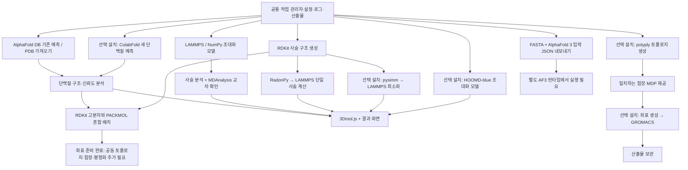

# REA 기반 소스·인터페이스 감사

이 프로젝트는 13개 공식 저장소에서 커밋을 고정한 핵심 소스와 라이선스 파일을 보관하고 실제 REA CLI를 실행했습니다. 기계 판독 결과는 [`evidence/repositories.json`](../evidence/repositories.json), 원본 명령 출력은 [`evidence/rea/`](../evidence/rea/), 원본 소스는 [`evidence/sources/`](../evidence/sources/)입니다.

## 실제 실행 범위

- **13개 저장소:** `rea import-reference-source --detail summary`. REA가 원본 소스 인벤토리, 언어, 파일 해시, historical-reference manifest를 생성했습니다.
- **3Dmol.js:** 위 작업에 더해 `rea analyze-javascript-application`. 보관한 TypeScript/JavaScript의 정적 모듈·import 그래프와 근거를 생성했습니다. 전체 저장소가 아니어서 일부 import가 unresolved입니다.
- **환경:** `rea capabilities`, `rea providers` 결과를 보관했습니다.
- **지원되지 않는 경로도 기록:** `inspect-artifact`에 일반 Python 소스 디렉터리를 넣으면 `directory_requires_file` 오류가 발생합니다. [`radonpy.artifact.json`](../evidence/rea/radonpy.artifact.json)에 실제 오류를 남겼습니다.

`import-reference-source`는 Python/C++/Fortran 디컴파일러가 아닙니다. 아래 API 연결 설명은 보관한 원본 소스를 직접 검토한 결과이며 REA가 과학 계산의 정확성이나 패키지 설치를 검증했다는 의미가 아닙니다. 이 감사에는 네이티브 디컴파일, AlphaFold 가중치 분석 또는 모델 추론이 포함되지 않습니다.

## 현재 구현한 작업 연결

아래는 작업 관리자가 제공하는 실제 분기입니다. `선택 설치` 표시는 어댑터가 있으나 해당 런타임·파라미터가 준비되어야 실행되는 경로입니다. 프로그램은 없는 엔진을 실행했다고 표시하지 않고 입력을 보존한 뒤 `blocked` 또는 `prepared` 상태로 종료합니다.



각 경로는 공통 작업 ID, 설정, 단위, 난수 시드, 로그, 산출물을 보관하고 계산 엔진이 제공한 버전 정보를 기록합니다. 합성고분자 모델과 단백질 예측은 입력과 물리적 의미가 달라 명시적인 작업 분기로 구성합니다. 단백질 결과를 PACKMOL에 이어서 혼합 좌표를 만들 수 있지만, 이 혼합계를 바로 LAMMPS에 넘겨 전원자 MD를 하는 자동 파라미터화는 구현하지 않았습니다. 토폴로지·프로톤화·공동 힘장·용매화·평형화 단계가 추가로 필요합니다. AlphaFold 3는 현재 입력 내보내기이며 앱 안에서 AF3 추론을 실행하지 않습니다. GROMACS 산출물의 MDAnalysis 자동 후처리도 현재 구현 범위에 포함하지 않습니다.

## 소스에서 검토한 인터페이스

이 표는 소스 API 조사 결과입니다. 표에 기재된 모든 기능이 현재 앱에서 자동 실행된다는 의미는 아니며 실행 범위는 위 다이어그램과 개별 작업의 상태·결과를 따릅니다.

| 구성 요소 | 검토한 주요 연결점 | 입력 → 출력 |
|---|---|---|
| RadonPy | `polymerize_rw`, `amorphous_cell`, `LAMMPS.exec`, eq preset | RDKit Mol·힘장·조건 → 셀·계산 입력·결과 |
| LAMMPS | `lammps.file`, `commands_string` | 입력 스크립트·데이터 → 로그·궤적·재시작 파일 |
| RDKit | `Chem` 파일 API, `AllChem` 거리기하·힘장 helper | SMILES/SDF → Mol·conformer |
| MDAnalysis | `Universe`, `PersistenceLength` | 토폴로지·궤적 → 좌표·사슬 분석 |
| 3Dmol.js | `createViewer`, `addModel`, `GLModel` | 구조 텍스트·스타일 → 3D 화면 |
| PACKMOL | Fortran 실행부·`getinp` | 구조·개수·거리/영역 설정 → 초기 배치 좌표 |
| pysimm | `LAMMPS_EXEC`, `lmps.Simulation.run` | System·실행 설정 → LAMMPS 결과 |
| polyply | `gen_params`/`gen_itp`, `gen_coords` | 잔기·힘장 블록 → ITP/GRO |
| GROMACS | `gmx_grompp`, `gmx_mdrun` | MDP·TOP·좌표 → TPR → 궤적·에너지 |
| HOOMD-blue | `Simulation`, GSD/Snapshot, `Integrator`, `run` | 조대화 상태·힘 정의 → 계산 상태·GSD |
| AlphaFold 2 | `run_alphafold.py`, `predict_structure` | FASTA·모델·DB → 구조·신뢰도 |
| ColabFold | `colabfold_batch`, `run`, `main` | FASTA/A3M·모델 → 구조·score JSON |
| AlphaFold 3 | JSON/model/output flags, `predict_structure` | 생체분자 JSON·모델·DB → mmCIF·신뢰도 |

정확한 커밋·파일 SHA-256·근거 행 번호·GitHub 영구 링크는 각 `repositories[].entrypoints`에 있습니다. `source_files`의 Git blob SHA 검증은 보관 파일이 읽은 원본과 byte 단위로 같음을 확인합니다. `snapshot_scope`는 모두 `selected_entrypoints_not_complete_repository`입니다. 아직 읽지 않은 내부 구현·의존성까지 검토했다고 주장하지 않습니다.

## 라이선스와 실행 조건의 기록

각 저장소의 실제 LICENSE/COPYING 파일을 함께 보관했습니다. 현재 고정 커밋에서는 RadonPy/RDKit/HOOMD-blue/3Dmol은 BSD 계열, PACKMOL/pysimm/ColabFold는 MIT, polyply/AlphaFold 2/AlphaFold 3 소스는 Apache-2.0입니다. LAMMPS는 GPL-2.0, GROMACS COPYING은 LGPL-2.1, MDAnalysis의 현재 LICENSE는 LGPL-3.0-or-later를 명시합니다. 실제 배포에는 해당 전체 라이선스와 포함 구성요소의 조건을 적용합니다.

AlphaFold 계열의 소스 코드와 모델 가중치·데이터베이스·출력 이용 조건은 별개입니다. 특히 AlphaFold 3의 보관된 `WEIGHTS_TERMS_OF_USE.md`는 별도 사용 조건을 명시합니다. 감사 스냅샷은 가중치를 포함하지 않습니다. ColabFold의 MSA 서버 사용 여부 또한 실행 설정에 명시해야 하며 감사 작업은 서열을 서버로 보내지 않았습니다.

## 재실행

```sh
python3 tools/rea/bootstrap.py
python3 scripts/audit_repos.py --run-rea
```

정상 종료 시 13개 저장소와 60개 파일을 검증했다는 메시지가 나옵니다. `--refresh-sources`는 기본 브랜치 최신 파일이 아니라 고정한 커밋의 원본을 다시 받습니다. 새 버전을 감사하려면 `catalog.json`의 커밋·파일 Git blob SHA를 함께 갱신하고 연결 지점과 라이선스를 다시 검토해야 합니다.
